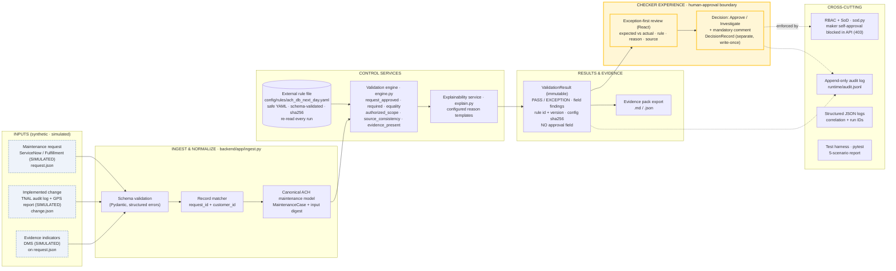
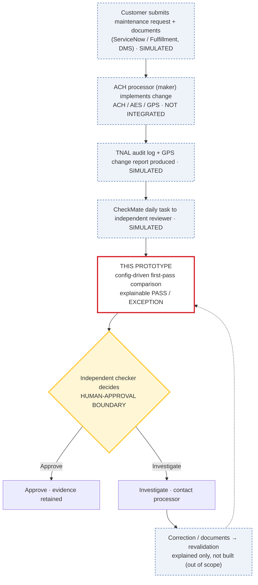

# Architecture and process flow

> SYNTHETIC DATA · SIMULATED SYSTEMS · PROTOTYPE. Not production-ready; not a replacement for existing controls.

## 1. Component architecture (organizer reference pattern)

**Human-approval boundary.** Everything left of the checker experience is automated comparison. The engine result type
(`ValidationResult`) has no approval field. The only object that can carry Approve is `DecisionRecord`, which the API
creates only for a CHECKER persona who did not implement the change.

## 2. Where the prototype sits in C-247489

## 3. Request lifecycle

| Step | Component | Output | Trace kept |
|---|---|---|---|
| 1 | `ingest.parse_inputs` | Typed request + change | Structured schema errors with source and field path |
| 2 | `ingest.match_records` | Matched pair | Rejects mismatched request_id / customer_id |
| 3 | `ingest.build_case` | `MaintenanceCase` | sha256 input digest |
| 4 | `config.load_ruleset` | Validated rule set | File name, version, sha256; snapshot in `runtime/configs/` |
| 5 | `engine.evaluate` | Findings in config order | Rule id + version, expected/actual values and their sources |
| 6 | `explain.render` | Reason text | From the configured template only |
| 7 | API `POST /api/runs` | `ValidationResult` | Audit `VALIDATION_RUN_COMPLETED`; `runtime/runs/<run>.json` |
| 8 | API `POST /api/runs/{id}/decision` | `DecisionRecord` or 403/422/409 | Audit `CHECKER_DECISION_RECORDED` or `DECISION_BLOCKED` |
| 9 | API `GET /api/runs/{id}/evidence` | Evidence pack | Inputs, config text, findings, decision, audit events |

## 4. Rule precedence

Rules run in the order listed in the YAML. One root cause produces one exception: if an enabled `required` rule covers a
field and the implemented value is blank or absent, the `equality` rule skips that field instead of also reporting a
mismatch. An `equality` rule with no `required` coverage still reports an absent value as a mismatch.
